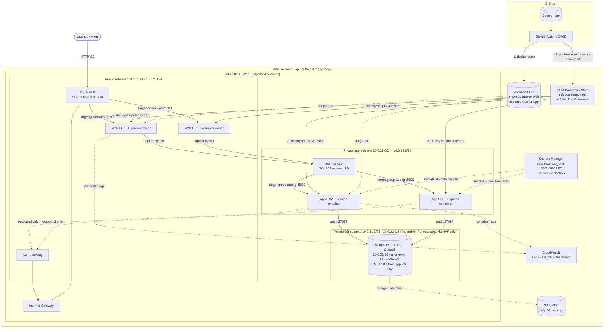

# Expense Tracker on AWS — Step-by-Step Deployment Log

**Course:** Cloud Computing (SE-490) — Complex Engineering Activity
**Cloud provider:** Amazon Web Services, region **ap-southeast-2 (Sydney)**
**Repository:** https://github.com/abdurrafey250904-hash/Expense-Tracker
**Live URL:** __APP_URL__

This file records every step taken to containerize, deploy and automate the three-tier
Expense Tracker, with a one-line explanation of each step, followed by the evidence
checklist, security design, NFR justification, cost estimate and teardown.

---

## 0. Is the application three-tier? — Yes

| Tier | Code | Technology | Runs on AWS as |
|---|---|---|---|
| Web / presentation | `frontend/` | React (Vite) SPA served by Nginx | Docker container on EC2 Auto Scaling Group in **public subnets**, behind the **public ALB** |
| Application / logic | `backend/` | Node.js + Express REST API (JWT auth, reports, PDF/CSV) | Docker container on EC2 Auto Scaling Group in **private subnets**, behind an **internal ALB** |
| Data | Mongoose models | MongoDB | **Self-managed MongoDB 7** on a dedicated EC2 host in the **private DB subnet**, data on a separate encrypted **EBS** volume, daily backups to **S3** |

---

## 1. Architecture diagram



> For the report, redraw this in draw.io / Lucidchart using the official AWS icons, keeping the
> same boxes: VPC → public / private-app / private-db subnets, the two ALBs, two ASGs,
> MongoDB EC2 host + EBS volume + S3 backups, NAT/IGW, ECR, Secrets Manager, CloudWatch and the GitHub Actions flow.

**Request path:** browser → public ALB → web container (Nginx serves the React files) →
for `/api/*` Nginx proxies → internal ALB → app container (Express) → MongoDB host.

---

## 2. Step-by-step log (what was done, in order)

### Phase A — Analysis
| # | Step | One-line explanation |
|---|---|---|
| A1 | Read the CEA brief and inspected the repository | Confirmed a React frontend, Express backend and MongoDB database = three tiers. |
| A2 | Chose AWS + EC2 Auto Scaling Groups + MongoDB | ASGs match the brief's "Auto Scaling Groups / pull image onto instances"; keeping MongoDB means no application rewrite. |
| A3 | Chose Terraform for all infrastructure | Infrastructure-as-code makes the whole environment reproducible and destroyable with one command (cloud-native enhancement). |

### Phase B — Application changes for the cloud
| # | Step | One-line explanation |
|---|---|---|
| B1 | Split `backend/server.js` into `app.js` (Express app) + `server.js` (listener) | Lets automated tests import the app without starting a server or database. |
| B2 | Added `/api/health` returning status, DB state and release version | Used by the internal ALB health check, Docker HEALTHCHECK and the pipeline's smoke test. |
| B3 | Added graceful SIGTERM shutdown and `trust proxy` | Rolling deploys/scale-in don't drop in-flight requests; client IPs are correct behind two ALBs. |
| B4 | Added `ENABLE_CRON` switch (false in AWS) | Prevents every horizontally-scaled replica sending the monthly email job N times. |
| B5 | Added unit tests `backend/tests/app.test.js` (`npm test`) | CI fails fast if health, 404 handling or auth protection break. |
| B6 | Frontend calls the API on the same origin (`/api`) | Browser never talks to the app tier directly — only Nginx (web tier) does. |

### Phase C — Containerization
| # | Step | One-line explanation |
|---|---|---|
| C1 | `backend/Dockerfile` (multi-stage, `node:20-alpine`, non-root `node` user, HEALTHCHECK) | Small, reproducible app-tier image with only production dependencies. |
| C2 | Bundled the Amazon DocumentDB CA certificate in the app image | Keeps the same image portable to managed DocumentDB (TLS) without a rebuild. |
| C3 | `frontend/Dockerfile` (stage 1 Vite build → stage 2 `nginx-unprivileged`) | Web-tier image is just static files + Nginx running as non-root on port 8080. |
| C4 | `frontend/nginx/default.conf.template` | SPA routing, `/healthz`, security headers, gzip, asset caching and the `/api` reverse proxy whose upstream is injected per environment. |
| C5 | `.dockerignore` files | Keeps `node_modules`, `.env` secrets and tests out of the images. |
| C6 | `docker-compose.yml` (web + app + mongo, two networks) | Runs all three tiers locally/in CI; web can't reach the DB network, mirroring the AWS segmentation. |

### Phase D — Tooling on the workstation
| # | Step | One-line explanation |
|---|---|---|
| D1 | `winget install Amazon.AWSCLI` | AWS CLI v2 to talk to the AWS account. |
| D2 | `winget install Hashicorp.Terraform` | Terraform to create the infrastructure. |
| D3 | `winget install GitHub.cli` | `gh` to set repository secrets/variables and watch pipeline runs. |
| D4 | Created IAM user with AdministratorAccess + access key, then `aws configure` | Gives the CLI/Terraform permission to build the environment. |
| D5 | `gh auth login` | Lets the CLI push code and manage GitHub Actions secrets. |
| D6 | Probed services per region → only **ap-southeast-2** is allowed; `iam:CreateOpenIDConnectProvider` is denied by the organization SCP | Explains the region choice and why CI uses a scoped IAM user instead of OIDC. |
| D7 | `aws configure set region ap-southeast-2` | Makes Sydney the default region for the CLI. |
| D8 | First `terraform apply` failed only at `CreateDBCluster` (DocumentDB): explicit deny in the Free-plan SCP; RDS `CreateDBInstance` is denied too | Managed databases are unavailable on this account, so the brief's alternative, a properly secured self-managed database, was implemented. |

### Phase E — Infrastructure as code (`infra/terraform/`)
| # | File | One-line explanation |
|---|---|---|
| E1 | `versions.tf` | Pins Terraform/AWS provider versions and tags every resource `Project=expense-tracker`. |
| E2 | `vpc.tf` — VPC `10.0.0.0/16` | Private address space for the whole system. |
| E3 | `vpc.tf` — 2 public subnets `10.0.1.0/24`, `10.0.2.0/24` | Internet-facing: public ALB, NAT gateway and web tier, across two AZs. |
| E4 | `vpc.tf` — 2 private app subnets `10.0.11.0/24`, `10.0.12.0/24` | Internal ALB and API instances with no public IPs. |
| E5 | `vpc.tf` — 2 private DB subnets `10.0.21.0/24`, `10.0.22.0/24` | Database host only; no public IPs, outbound-only route through the NAT (patches, image, backups). |
| E6 | `vpc.tf` — Internet Gateway + public route table (`0.0.0.0/0 → IGW`) | Internet connectivity for the public subnets. |
| E7 | `vpc.tf` — NAT Gateway + app route table (`0.0.0.0/0 → NAT`) | App instances can pull images/secrets outbound, but nothing can connect in. |
| E8 | `security_groups.tf` — 5 security groups chained ALB → web → internal ALB → app → DB | Each tier accepts traffic only from the security group directly in front of it. |
| E9 | `alb.tf` — public ALB + `web-tg` (health `/healthz`) | Distributes internet traffic across web instances in two AZs. |
| E10 | `alb.tf` — internal ALB + `app-tg` (health `/api/health`) | Distributes web-tier API calls across app instances; not internet-reachable. |
| E11 | `ecr.tf` — ECR repos `expense-tracker-web`, `expense-tracker-app` | Private container registry; immutable tags, scan-on-push, keep-last-10 lifecycle. |
| E12 | `ecr.tf` — SSM parameters `/expense-tracker/{web,app}/image_tag` | "Release pointer" the pipeline updates and new instances read at boot. |
| E13 | `database.tf` — EC2 `expense-tracker-mongodb` (t3.small, fixed IP 10.0.21.10, no public IP, IMDSv2) | Dedicated, hardened database host in the private DB subnet. |
| E14 | `database.tf` — separate 20 GB encrypted gp3 **EBS data volume** mounted at `/data/mongo` | Persistent block storage: data survives container restarts and host replacement (enhancement). |
| E15 | `user_data_db.sh.tftpl` — formats/mounts the volume once, runs `mongo:7 --auth` with logs to CloudWatch | MongoDB with authentication enabled, root password pulled from Secrets Manager. |
| E16 | `database.tf` — private, encrypted, TLS-only **S3 bucket** + 14-day lifecycle; daily systemd timer streams `mongodump --gzip` to it | Object storage for application backups (enhancement). |
| E17 | `monitoring.tf` — `db-auto-recover` alarm (`StatusCheckFailed_System` → EC2 recover) | Self-healing for the single DB host on hardware failure. |
| E18 | `secrets.tf` — Secrets Manager secrets `expense-tracker/app` and `expense-tracker/db` | Generated DB credentials, connection string and JWT secret — nothing hard-coded. |
| E19 | `iam.tf` / `database.tf` — per-tier instance roles | Each tier can pull only its own image, read only its own tag/secret, write only its own logs; the DB role may only write to `backups/` in the bucket. |
| E20 | `iam.tf` — `expense-tracker-github-deploy` IAM user + inline policy | CI identity limited to pushing the two ECR repos, updating the two tags and running commands on project-tagged instances. |
| E21 | `compute.tf` — launch templates (Amazon Linux 2023, t3.micro, IMDSv2, encrypted gp3 EBS) | Defines how every instance boots; containers cannot reach instance credentials. |
| E22 | `user_data.sh.tftpl` — installs Docker, writes `/opt/expense-tracker/deploy.sh` + a systemd unit | Each instance pulls the current release from ECR, injects secrets and runs the container with CloudWatch logging. |
| E23 | `compute.tf` — `expense-tracker-web-asg`, `expense-tracker-app-asg` (min 2 / max 4, 2 AZs, ELB health checks) | Horizontal scaling and self-healing for both container tiers. |
| E24 | `compute.tf` — target-tracking policies (CPU 50 %, ALB 1000 req/target) | Elasticity: instances are added/removed automatically with load. |
| E25 | `monitoring.tf` — log groups (web/app/db), SNS topic, alarms, dashboard | Centralized logging and monitoring (cloud-native enhancement). |
| E26 | `terraform init` → `terraform plan -out tfplan` → `terraform apply tfplan` (second apply after replacing DocumentDB: +25 / −6) | Built the entire environment reproducibly. |

### Phase F — CI/CD (`.github/workflows/ci-cd.yml`)
| # | Step | One-line explanation |
|---|---|---|
| F1 | Created an access key for `expense-tracker-github-deploy` and piped it straight into `gh secret set AWS_ACCESS_KEY_ID / AWS_SECRET_ACCESS_KEY` | Pipeline credentials live only in GitHub encrypted secrets — never in code or logs. |
| F2 | `gh variable set AWS_REGION` and `APP_URL` | Non-secret pipeline configuration. |
| F3 | Job **Backend unit tests** | `npm ci && npm test` on every push/PR. |
| F4 | Job **Frontend build** | Proves the React app compiles. |
| F5 | Job **Terraform fmt & validate** | Catches infrastructure mistakes before they reach AWS. |
| F6 | Job **Integration test** — `docker compose up --build --wait` then register → add expense → list through Nginx | Proves all three containers work together before anything is published. |
| F7 | Job **Build & push** (matrix web/app) | Builds both images with layer caching and pushes them to ECR tagged with the git commit SHA. |
| F8 | Job **Rolling deploy** — `.github/scripts/rolling-deploy.sh app` then `web` | Updates the SSM release tag, then runs `deploy.sh` on one instance at a time via SSM Run Command (no SSH), so the site stays up. |
| F9 | **Smoke test** through the public ALB | Pipeline only goes green when `/api/health` reports the new commit SHA and `db: connected`. |
| F10 | Committed and pushed to `main` | Triggered the first full pipeline run, which deployed the application. |

### Phase G — Verification
| # | Step | One-line explanation |
|---|---|---|
| G1 | Opened __APP_URL__ in a browser, registered, added expenses, viewed reports | End-to-end proof the running application works through all three tiers. |
| G2 | Checked both target groups show **healthy** targets | Load balancers see every instance as healthy. |
| G3 | Checked CloudWatch log groups `/expense-tracker/web` and `/expense-tracker/app` | Container logs arrive centrally. |
| G4 | Every later `git push` to `main` re-runs the pipeline | Continuous delivery: change → test → image → deploy without manual steps. |

---

## 3. Screenshot checklist (Deployment Evidence)

All in the AWS Console with region **Asia Pacific (Sydney) ap-southeast-2** selected.

| # | Evidence required | Where to click |
|---|---|---|
| 1 | Network/VPC + subnets | **VPC → Your VPCs** (`expense-tracker-vpc`); **Subnets** (filter `expense-tracker` – 6 subnets); **Route tables** (public → igw, private-app → nat, private-db → local only); **NAT gateways**; **Internet gateways** |
| 2 | Compute instances / container hosts | **EC2 → Instances** (4 running: 2 × `expense-tracker-web`, 2 × `expense-tracker-app`); **EC2 → Auto Scaling Groups** (both ASGs, *Automatic scaling* tab shows the policies) |
| 3 | Security groups | **EC2 → Security Groups** → open each of the 5 `expense-tracker-*-sg` → *Inbound rules* (show source = other SG) |
| 4 | Load balancer | **EC2 → Load Balancers** (public + internal); **Target Groups** → `expense-tracker-web-tg` / `-app-tg` → *Targets* tab all **healthy** |
| 5 | Database instance | **EC2 → Instances → `expense-tracker-mongodb`** (private IP 10.0.21.10, no public IP, subnet `private-db`, SG `expense-tracker-db-sg`); **EC2 → Volumes → `expense-tracker-db-data`** (encrypted, in-use); **S3 → `expense-tracker-db-backups-…`** |
| 6 | Docker image build + registry listing | **ECR → Repositories** → both repos → image list with SHA tags + scan status; plus the *Build & push* job log in GitHub Actions |
| 7 | CI/CD pipeline run | GitHub repo → **Actions → CI/CD** → green run showing all 7 jobs (tests → integration → build & push → deploy) |
| 8 | Running application | Browser at __APP_URL__ — login page, dashboard with charts, reports page |
| + | Extras (strengthen report) | **Secrets Manager** → `expense-tracker/app` (value hidden); **CloudWatch → Dashboards → expense-tracker**; **CloudWatch → Log groups**; **Systems Manager → Run Command → Command history** (deploy commands from CI) |

---

## 4. Security design

| Control | How it is implemented |
|---|---|
| Per-tier firewalls | 5 security groups; inbound only from the previous tier's SG (public ALB ← internet :80; web ← public ALB :80; internal ALB ← web :80; app ← internal ALB :5000; MongoDB ← app :27017). |
| Network segmentation | Public / private-app / private-db subnets; app and DB hosts have no public IPs and egress only via NAT (nothing can connect in); the internal ALB is not internet-facing. |
| Least privilege (IAM) | Separate instance roles per tier scoped to single ECR repo, single SSM parameter, single log group; only the app role can read the one secret; CI user can only push 2 repos, set 2 parameters and run commands on `Project=expense-tracker` instances. |
| Secrets management | DB password and JWT secret generated by Terraform, stored in **Secrets Manager** (separate app and db secrets), fetched at container start into `chmod 600` env files; CI keys are **GitHub encrypted secrets**; `.env`, `*.tfvars` and Terraform state are git-ignored. |
| Encryption | All EBS volumes (incl. DB data) encrypted at rest; S3 backups SSE-encrypted with a TLS-only bucket policy and public access blocked; ECR encrypted. MongoDB authentication enforced. |
| Host hardening | No SSH / no key pairs (SSM Session Manager instead); IMDSv2 required with hop-limit 1 so containers can't steal instance credentials; containers run as non-root. |
| Supply chain | Immutable image tags (git SHA), ECR scan-on-push, tests + integration test gate every deploy. |
| Known gap | App→DB traffic stays inside the VPC and is SG-restricted but is not TLS-encrypted (self-managed Mongo without certificates); fix: MongoDB TLS certificates or DocumentDB. HTTP only (no domain → no ACM certificate). Fix: Route 53 domain + ACM cert + HTTPS listener with HTTP→HTTPS redirect. CI uses an access key because the account SCP blocks OIDC; with OIDC allowed, switch to short-lived role credentials. |

---

## 5. NFR justification

| NFR | Design decisions that support it | Limitations / improvement |
|---|---|---|
| **Scalability** | Stateless containers (JWT auth, no server session) behind ALBs; two independent ASGs (web, app) scale 2 → 4 horizontally; the database could become a sharded/replicated MongoDB cluster. | Max 4 per tier to protect free credits; raise `max` in `variables.tf`. |
| **Availability / Reliability** | Web and app tiers span **2 AZs** with ≥2 instances each; ELB health checks replace failed instances automatically; Docker `--restart`; DB host has EC2 auto-recovery, data on a separate EBS volume and daily S3 backups. | **The database is a single instance in one AZ, the main single point of failure.** Improve with a 3-node MongoDB replica set across AZs or a managed DocumentDB cluster (blocked on this Free-plan account); single NAT GW → one NAT per AZ. |
| **Elasticity** | Target-tracking scaling on average CPU (50 %) for both ASGs and on ALB requests per target for the web tier — scales out and back in automatically. | Scale-out takes ~2–3 min (instance boot + image pull); a pre-baked AMI or ECS/Fargate would be faster. |
| **Security** | See section 4: SG chaining, private subnets, least-privilege IAM, Secrets Manager, TLS, IMDSv2, no SSH, scanned immutable images. | HTTPS and OIDC as noted above; add AWS WAF on the public ALB. |
| **Maintainability / Deployability** | Everything is code (Terraform, Dockerfiles, workflow); every push runs tests → integration test → build → rolling deploy → smoke test; a release is just a git SHA, so rollback = re-run an older pipeline. | Terraform is applied manually (state is local); move state to S3 + DynamoDB lock and add a `terraform plan` job. |
| **Performance / Latency** | Nginx serves static assets with gzip and 1-year immutable caching; ALBs balance load; app and DB in the same region/VPC; gp3 EBS for the DB; indexes on `user+date` and `user+category`. | Add CloudFront CDN in front of the web tier and ElastiCache for report queries. |
| **Cost-Efficiency** | Free-tier-eligible `t3.micro`/`t3.small` instances, self-managed DB instead of a ≈$70/month managed cluster, one NAT gateway, ECR lifecycle policy, 14-day log retention, auto scaling keeps only 2 instances per tier at idle, everything destroyable with `terraform destroy`. | See section 6 for further measures. |
| **Portability** | All three tiers run as standard Docker images (`nginx-unprivileged`, `node`, `mongo:7`) configured only through environment variables; the same images run locally with `docker compose`, on EC2 here, and could run on ECS, EKS, AKS or GKE unchanged; switching to Atlas/DocumentDB only changes `MONGO_URI`. | Terraform is AWS-specific (would need rewriting per provider). |

---

## 6. Monthly cost estimate (ap-southeast-2, on-demand, approximate)

Verify/screenshot with the AWS Pricing Calculator: https://calculator.aws/ (add each line below).

| Service | Configuration | ≈ USD / month |
|---|---|---|
| EC2 | 4 × t3.micro (2 web + 2 app), 730 h | 38.50 |
| EBS | 4 × 10 GB gp3 | 3.85 |
| Application Load Balancer | 2 ALBs (public + internal), low LCU | 48.00 |
| NAT Gateway | 1 × 730 h + ~5 GB processed | 43.40 |
| Public IPv4 addresses | NAT EIP + 2 web instances + 2 ALB nodes | 18.25 |
| MongoDB host | 1 × t3.small (730 h) + 10 GB root + 20 GB data gp3 | ≈ 22.50 |
| S3 backups | < 1 GB, 14-day retention | ≈ 0.05 |
| Secrets Manager, ECR, CloudWatch, SNS, SSM | 1 secret, < 1 GB images, logs/alarms/dashboard | ≈ 6.00 |
| **Total** | | **≈ 180 / month (≈ 6 / day)** |

The account is on the AWS **Free plan with $100 credits** (plus earnable activity credits), so a
1–2 day deployment for the demo costs roughly $6–12 of credits and **$0 of real money**.

**Cost-optimization measures**
1. **Tear down / schedule:** `terraform destroy` after the demo; for a longer-lived dev environment, scale ASGs to 0 and stop the DB host at night (stopped clusters bill storage only).
2. **Replace the NAT gateway with VPC endpoints** (ECR api/dkr, S3, SSM, Secrets Manager, CloudWatch Logs) or a NAT instance — removes the ~$43/month NAT charge for traffic that only goes to AWS services.
3. **Graviton + right-sizing:** `t4g.micro`/`t4g.small` instances are ~20 % cheaper (images built multi-arch); Savings Plans / Reserved Instances for a 1-year commitment cut compute 30–40 %.
4. **Collapse the web tier into a single ALB with path routing** or serve the React build from S3 + CloudFront — removes 2 instances, 2 public IPs and one ALB.

---

## 7. How to reproduce from scratch

```powershell
# prerequisites: AWS CLI, Terraform, GitHub CLI logged in; region ap-southeast-2
cd infra/terraform
terraform init
terraform apply                                   # ~5 min

# CI credentials -> GitHub encrypted secrets (never printed)
aws iam create-access-key --user-name expense-tracker-github-deploy --output json > key.json
# (then gh secret set AWS_ACCESS_KEY_ID / AWS_SECRET_ACCESS_KEY from key.json, delete key.json)
gh variable set AWS_REGION --body ap-southeast-2
gh variable set APP_URL   --body (terraform output -raw app_url)

git push origin main                              # pipeline builds, pushes and deploys
```

## 8. Teardown (stop all credit usage)

```powershell
cd infra/terraform
aws iam list-access-keys --user-name expense-tracker-github-deploy   # delete the CI key first:
aws iam delete-access-key --user-name expense-tracker-github-deploy --access-key-id <KEY_ID>
terraform destroy                                  # removes everything incl. DB volume and backups (~5 min)
```
